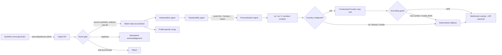
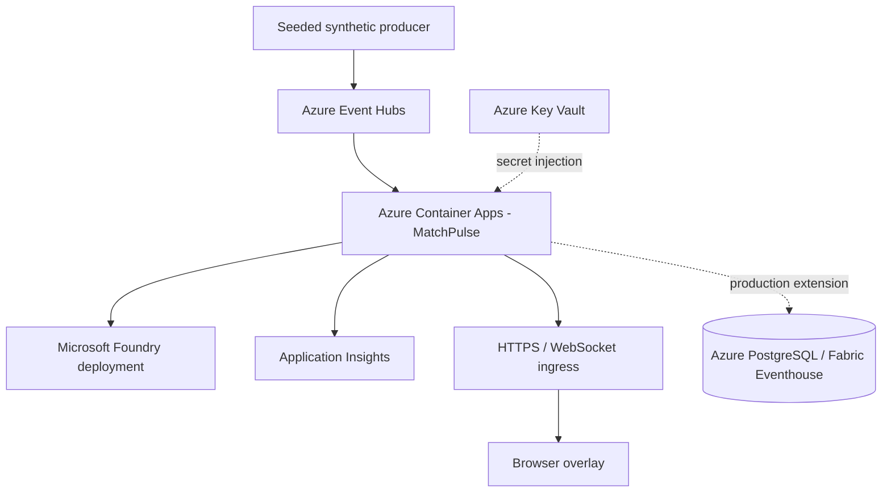

# MatchPulse Live architecture

**Status:** implementation-ready MVP with a tested local path and an Azure deployment template. Azure resources, public URL, and Foundry credentials still require entrant deployment.

## 1. Outcomes

MatchPulse Live accepts synthetic, football-realistic events as they occur and produces:

1. meaningful match state and statistics;
2. an evidence chain explaining why a moment matters;
3. timed, machine-readable overlays suitable for a live screen;
4. genuinely different analyst, broadcaster, and fan experiences;
5. English, Spanish, and French narratives; and
6. profile-specific automated recaps.

Target service objectives for the submission demo:

| Objective | Target | Design control |
|---|---:|---|
| Deterministic ingest-to-overlay p95 | < 750 ms | In-process state, bounded work, no model dependency |
| Foundry-enriched insight p95 | < 2.5 s | 1.4 s model timeout, fallback to deterministic copy |
| Event loss in local demo | 0 accepted events | Event ID idempotency + monotonic sequence check |
| Unsupported factual claims | 0 | Evidence gate + model numeric-claim guard |
| Supported demo languages | 3 | Curated template catalogs for en/es/fr |
| Live client backpressure | Bounded | 64-message queue, drop oldest stale overlay |

These are targets until measured in the entrant's final deployment; the preflight and tests validate the controls, not production SLO attainment.

## 2. Logical flow

### One pipeline, five challenge stages

| Challenge stage | MatchPulse component | Output |
|---|---|---|
| Ingest | `POST /v1/events`, batch API, seeded generator | Validated event with source, sequence, and clock |
| Interpret | `MatchAccumulator` + interpretation agent | Team state, pass difficulty, shot speed, pressing windows, possession swing |
| Explain | Explainability agent | Evidence event IDs, calculation inputs, formula, confidence |
| Render | Narrative/localization catalog + WebSocket | Timed overlay payload and browser demo |
| Personalize | Profile score + persona/detail/locale renderer | Analyst, fan, and broadcaster variants from one insight |

## 3. Purposeful agent design

- **Supervisor agent:** owns handoffs, shared state, warnings, and failure isolation.
- **Interpretation agent:** converts one accepted event into zero or more football signals. It is deterministic and testable.
- **Explainability agent:** blocks any signal whose referenced events do not exist or whose derivation is missing.
- **Personalization agent:** scores relevance using persona, favorite club/player, metric interests, and severity; it also selects compact, standard, or deep detail.
- **Foundry narrative adapter (optional):** copy-edits grounded text only. It cannot alter evidence or stats. New numeric claims, malformed JSON, timeout, or service errors trigger a deterministic fallback.

A single model prompt does not perform the entire job. Each agent has a distinct contract, shared state is explicit, handoffs are measured, and failures are contained.

## 4. Real-time match state and explainability

### Implemented calculations

- **Pass difficulty:** `min(100, distance*1.15 + progressive*0.55 + pressure*28)`.
- **Shot-speed highlight:** measured speed at or above 95 km/h.
- **Pressing surge:** at least three pressure events at intensity 0.72+ by one team in the trailing 30 seconds.
- **Possession swing:** a change of at least 10 percentage points between synthetic snapshots.
- **High regain:** a successful tackle in the attacking 35% of the pitch.

Every output carries the underlying event IDs and the formula/threshold used. The system says why a moment matters without asking a language model to invent match state.

## 5. Personalization contract

An `AudienceProfile` contains:

- persona: analyst, fan, or broadcaster;
- locale: en, es, or fr;
- favorite club and player;
- metric interests: passing, shooting, pressing, possession, defending;
- detail: compact, standard, or deep;
- accessibility preferences.

The same insight retains one `insight_id` and one evidence object across every variant. Only priority and presentation change. This makes personalization auditable and lets a judge compare modes side by side.

## 6. Cloud deployment architecture

The supplied Bicep deploys Container Apps, Event Hubs, Log Analytics, and Application Insights. The MVP accepts HTTP events directly so judges can test it without another producer. Event Hubs is the scale-out seam. A production deployment should add a consumer checkpoint store and durable event/state persistence; these are intentionally outside the seven-day challenge MVP.

## 7. Deployment boundary

MatchPulse Live is a **standalone sidecar**. It is designed to run next to other systems without coupling to them:

- it is deployed on its own resource group, container registry entry, and container app;
- it never calls, and is never called by, an approval, identity, invitation, assignment, or player-delivery endpoint;
- it never connects to an external database; the challenge module needs no durable store;
- it keeps its own API surface, its own synthetic dataset, and its own deployment and security conventions;
- it can be published as a clean standalone public repository without exposing any neighbouring system.

A production deployment should add a consumer checkpoint store and durable
event/state persistence for the Event Hubs path; these are intentionally
outside the challenge MVP.

## 8. Security, privacy, and IP

- Schema permits only `source="synthetic"`.
- API refuses startup behavior when the synthetic-only safety gate is disabled.
- Container runs non-root, read-only, with all Linux capabilities dropped in Compose.
- Secrets are excluded from the repository and injected at runtime.
- Foundry output is non-authoritative and bounded by evidence.
- Demo assets use text/CSS only; no copyrighted match footage, music, club crests, or league marks.
- Logs must never include credentials, real player identifiers, or raw third-party data.

## 9. Operational failure modes

| Failure | Behavior | Recovery |
|---|---|---|
| Duplicate event | Acknowledge; no state or insight duplication | Producer may retry safely |
| Out-of-order event | HTTP 409 | Replay from last accepted sequence |
| Foundry timeout/error | Deterministic narrative | Alert through warning; no live interruption |
| Foundry adds unsupported number | Reject rewrite | Use original evidence-backed copy |
| Slow WebSocket consumer | Drop oldest stale overlay | Newest relevant moment remains visible |
| Missing profile | 404/4404 | Select or create a valid profile |
| Malformed/non-synthetic data | 422 | Fix producer contract; no partial processing |

## 10. Decisions deferred beyond submission

- Durable multi-region state and replay checkpoints.
- Human-reviewed expansion beyond en/es/fr.
- Automatic computer vision eventing from licensed footage.
- Fabric Eventhouse dashboards and offline model evaluation.
- Per-user authentication, consent, and preference persistence.
- Load-tested multi-replica WebSocket fan-out through a managed backplane.
