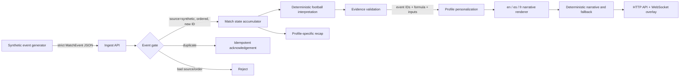
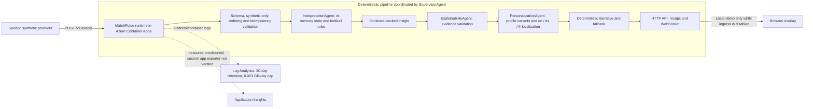

# MatchPulse Live architecture

**Status:** the immutable Azure Container Apps candidate passed hosted
validation. A fresh read-only check on 2026-10-26 confirmed the configured
image digest and no ingress configuration. No Foundry runtime setting or
model deployment was found; the recorded run made zero model calls. The
resource-group inventory returned seven resources, including a Cognitive
Services account and project, rather than the earlier expected five. The
current checkout contains post-deployment local changes that are not included
in the deployed image. This document describes the current source design
unless it explicitly identifies deployed state.

## 1. Outcomes

MatchPulse Live accepts synthetic, football-realistic events as they occur and produces:

1. meaningful match state and statistics;
2. an evidence chain explaining why a moment matters;
3. timed, machine-readable overlays suitable for a live screen;
4. genuinely different analyst, broadcaster, and fan experiences;
5. English, Spanish, and French narratives; and
6. profile-specific automated recaps.

Target service objectives for the submission demo:

| Objective | Target | Design control |
|---|---:|---|
| Deterministic ingest-to-overlay p95 | < 750 ms | In-process state, bounded work, no model dependency |
| **ROADMAP — NOT IN CURRENT SUBMISSION** optional Foundry-enriched insight p95 | < 2.5 s | Target only if separately enabled; 1.4 s timeout and deterministic fallback |
| Event loss in local demo | 0 accepted events | Event ID idempotency + monotonic sequence check |
| Unsupported factual claims | 0 | Evidence gate + model numeric-claim guard |
| Supported demo languages | 3 | Curated template catalogs for en/es/fr |
| Live client backpressure | Bounded | 64-message queue, drop oldest stale overlay |

These are targets until measured in the entrant's final deployment; the preflight and tests validate the controls, not production SLO attainment.

## 2. Logical flow

### One specialized processing pipeline, five challenge stages

| Challenge stage | MatchPulse component | Output |
|---|---|---|
| Ingest | `POST /v1/events`, batch API, seeded generator | Validated event with source, sequence, and clock |
| Interpret | `MatchAccumulator` and deterministic rules | Team state, pass difficulty, shot speed, pressing windows, possession swing |
| Explain | Evidence validation stage | Evidence event IDs, calculation inputs, formula, confidence |
| Render | Narrative/localization catalog + WebSocket | Timed overlay payload and browser demo |
| Personalize | Profile score + persona/detail/locale renderer | Analyst, fan, and broadcaster variants from one insight |

## 3. Specialized processing stages

The Python classes in `src/matchpulse/agents.py` include legacy `Agent`
suffixes, but the implementation is a deterministic processing pipeline, not
an autonomous or multi-agent system. Each stage is ordinary application code:

- **Event interpretation:** applies event rules and updates shared in-process
  match state.
- **Evidence validation:** rejects an insight if its referenced events or
  derivation are missing.
- **Profile personalization:** scores relevance and selects detail using the
  persona, favorites, metric interests, and severity.
- **Localization:** renders deterministic English, Spanish, and French text.
- **ROADMAP — NOT IN CURRENT SUBMISSION** — The optional Foundry adapter can
  copy-edit grounded text only when separately configured. It cannot alter
  evidence or stats; unsupported numbers, malformed JSON, timeouts, and
  service errors use deterministic output. It was off in the validated
  deployment, which made zero model calls.

The source contains a coordinator that calls these components, but it does
not make them autonomous agents or use a model to choose tools or actions.

## 3a. Submission trace decision — documentation only

`AGENT_TRACE_DECISION=DEFERRED`

The supervisor currently measures its internal interpretation, evidence-check,
and personalization handoffs, but the event API discards those handoff records.
The application does expose evidence event IDs and derivation details on
insights, and evidence event IDs on recaps and audience variants; it does not
return a sanitized handoff trace or render a dedicated “Why this insight?”
expander.

This submission therefore claims evidence-grounded processing, not a visible
agent-handoff trace or autonomous multi-agent behavior. A future additive trace
could expose a shared evidence ID, runtime mode, grounding status, and
sanitized stage status and duration. Stage names must come only from actual
code-reported handoffs (`interpretation-agent`, `explainability-agent`, and
`personalization-agent`); localization is not an `AgentHandoff` stage. A
compact accessible `
` view could show this metadata beside the
existing evidence, with no chain-of-thought, prompts, model responses,
exception details, profile identifiers, paths, credentials, or Azure resource
IDs.

The trace is deferred because publication blockers take priority, the approved
video does not show it, runtime/API/UI work could create inconsistencies, no
deployment is authorized, and regression plus publication work comes first.
The voice-rights review also remains unresolved. No runtime or video change is
made for this deferred design.

## 4. Real-time match state and explainability

### Implemented calculations

- **Pass difficulty:** `min(100, distance*1.15 + progressive*0.55 + pressure*28)`.
- **Shot-speed highlight:** measured speed at or above 95 km/h.
- **Pressing surge:** at least three pressure events at intensity 0.72+ by one team in the trailing 30 seconds.
- **Possession swing:** a change of at least 10 percentage points between synthetic snapshots.
- **High regain:** a successful tackle in the attacking 35% of the pitch.

Every output carries the underlying event IDs and the formula/threshold used. The system says why a moment matters without asking a language model to invent match state.

## 5. Personalization contract

An `AudienceProfile` contains:

- persona: analyst, fan, or broadcaster;
- locale: en, es, or fr;
- favorite club and player;
- metric interests: passing, shooting, pressing, possession, defending;
- detail: compact, standard, or deep;
- accessibility preferences.

The same insight retains one `insight_id` and one evidence object across every variant. Only priority and presentation change. This makes personalization auditable and lets a judge compare modes side by side.

`GET /v1/matches/{id}/variants` exposes that comparison as data: one
authoritative moment with its evidence event ids and statistics, plus the
presentation each audience receives. A `locale` query parameter overrides every
audience's language for the request, so a judge can read the same moment in
English, Spanish, and French without switching profiles.

## 5a. Bounded demo runs

A judge should be able to see the system work without a terminal, so the
server can seed a match itself. A demo run is deliberately constrained:

| Control | Value |
|---|---|
| Match identifier | `demo-<uuid12>`, unique per run, so no run inherits another run's state |
| Event source | The existing deterministic synthetic generator only |
| Event cap | 24 |
| Cooldown | 20 seconds between runs |
| Concurrency | One run in flight at a time |
| Subscriber wait | The run waits for a WebSocket subscriber before emitting |
| Safety | The synthetic-only gate still applies to every ingested event |

`POST /v1/demo/runs` returns `409` while a run is in flight and `429` during
the cooldown window. `GET /v1/demo/runs/{run_id}` reports the lifecycle.

## 5b. Optional telemetry

Telemetry is opt-in and allowlist-only. With no exporter configuration the
application behaves exactly as it did before telemetry existed: every
`record_*` call is a no-op. When enabled, the only recorded signals are route
template, method, status, duration, accepted/rejected/duplicate event counts,
Foundry attempt/success/fallback/rejection counts, Foundry latency, and
WebSocket connect/disconnect/send/drop counts.

Request bodies, response bodies, prompts, model output, evidence text,
authorization data, cookies, client IPs, tokens, connection strings, and
arbitrary match or event identifiers are never exported and are never used as
metric dimensions. A route template that looks like a concrete identifier is
rejected. Exporter failures are contained and never break a request.

## 6. Cloud deployment architecture

`SupervisorAgent`, `InterpretationAgent`, `ExplainabilityAgent`, and
`PersonalizationAgent` are synchronous deterministic code components. They are
not autonomous model-driven agents or a model-planning loop; localization is
handled by deterministic catalogs.

The deployed Container App has no ingress configuration in the fresh
2026-10-26 read-only ARM response. The supplied template provisions Container
Apps, Log Analytics, and Application Insights. The app
accepts HTTP events directly; Event Hubs is not deployed and no consumer,
checkpoint store, or processed-message trace exists. The configured replica
range is 0–1 because state and WebSocket subscriptions are process-local.
Application Insights is provisioned, but custom application telemetry is not
verified for the deployed image. A production deployment would require durable
state/replay and a shared WebSocket backplane before scale-out.

## 7. Deployment boundary

MatchPulse Live is a **standalone sidecar**. It is designed to run next to other systems without coupling to them:

- it is deployed on its own resource group, container registry entry, and container app;
- it never calls, and is never called by, an approval, identity, invitation, assignment, or player-delivery endpoint;
- it never connects to an external database; the challenge module needs no durable store;
- it keeps its own API surface, its own synthetic dataset, and its own deployment and security conventions;
- it can be published as a clean standalone public repository without exposing any neighbouring system.

A production deployment should add durable
event/state persistence; these are intentionally
outside the challenge MVP.

## 8. Security, privacy, and IP

- Schema permits only `source="synthetic"`.
- API refuses startup behavior when the synthetic-only safety gate is disabled.
- Container runs non-root, read-only, with all Linux capabilities dropped in Compose.
- Secrets are excluded from the repository and injected at runtime.
- Foundry output is non-authoritative and bounded by evidence.
- Demo assets use text/CSS only; no copyrighted match footage, music, club crests, or league marks.
- Logs must never include credentials, real player identifiers, or raw third-party data.

## 9. Operational failure modes

| Failure | Behavior | Recovery |
|---|---|---|
| Duplicate event | Acknowledge; no state or insight duplication | Producer may retry safely |
| Out-of-order event | HTTP 409 | Replay from last accepted sequence |
| Foundry timeout/error | Deterministic narrative | Alert through warning; no live interruption |
| Foundry adds unsupported number | Reject rewrite | Use original evidence-backed copy |
| Slow WebSocket consumer | Drop oldest stale overlay | Newest relevant moment remains visible |
| Missing profile | 404/4404 | Select or create a valid profile |
| Malformed/non-synthetic data | 422 | Fix producer contract; no partial processing |

## 10. Decisions deferred beyond submission

- **ROADMAP — NOT IN CURRENT SUBMISSION** — Durable multi-region state and replay checkpoints.
- **ROADMAP — NOT IN CURRENT SUBMISSION** — Human-reviewed expansion beyond en/es/fr.
- **ROADMAP — NOT IN CURRENT SUBMISSION** — Automatic computer vision eventing from licensed footage.
- **ROADMAP — NOT IN CURRENT SUBMISSION** — Fabric Eventhouse dashboards and offline model evaluation.
- **ROADMAP — NOT IN CURRENT SUBMISSION** — Per-user authentication, consent, and preference persistence.
- **ROADMAP — NOT IN CURRENT SUBMISSION** — Load-tested multi-replica WebSocket fan-out through a managed backplane.
