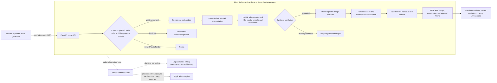

# MatchPulse Live reproducibility

This page separates what can be rerun from a source checkout from what
requires local media and external speech assets. “Reproducible” here means
repeatable application behavior where stated; it does not promise identical
container bytes, speech waveforms, or a bit-identical MP4.

## Reproducibility levels

| Level | Scope | Status |
|---|---|---|
| 1 — Application | Install the Python application, run its tests, send generated synthetic events, and inspect the API/demo. | A disposable clone of `HEAD` with the exact proposed A/B file allowlists overlaid passed installation, tests, lint, preflight, solution validation, and a 24-event seeded replay with an evidence-grounded Spanish recap. Four tests skipped: the optional real-attestation check and three tests requiring excluded local narration inputs. Python and dependency versions are range-constrained, not locked, so installs and image builds are not guaranteed byte-for-byte identical. |
| 2 — Narration tooling | Final narration: the ElevenLabs tooling (`docs/ELEVENLABS_NARRATION.md`) with an entitled account and the local-only script input. Historical, superseded: the optional local Kokoro narration helpers with separately supplied narration inputs, model/voice files, and local TTS image. | The clean-clone unit suite passed; three V2 checks skipped because the approved script, captions, and manifest are local-only inputs. Model/voice hashes, the resolved `kokoro-onnx` version, and TTS image digest are not pinned. Actual clean-clone narration generation is not established. |
| 3 — Exact approved video | Recreate the approved 115-second video from its archived hosted visual source, narration script/captions, audio, and rendering toolchain. | Not reproducible from a clean public-source clone. The visual source is a local archived input and submission media is not in the clean clone; required external asset hashes and some tool versions are unavailable. No bit-identical rebuild is claimed. |

## Level 1: application

### Requirements declared by the project

The project requires Python 3.11 or newer. `pyproject.toml` constrains direct
dependencies to these ranges; it does not contain a dependency lockfile:

| Dependency | Declared range |
|---|---|
| FastAPI | `>=0.115,<1` |
| Uvicorn | `>=0.30,<1` |
| Pydantic | `>=2.8,<3` |
| HTTPX | `>=0.27,<1` |
| pytest (development) | `>=9.0.3,<10` |
| Ruff (development) | `>=0.8,<1` |

The versions below were observed in the preparation environment on
2026-10-26. They are observations, not project pins or proof that another
machine will resolve the same dependencies:

| Tool | Observed version |
|---|---|
| Python | `3.12.0` |
| pip | `23.2.1` |
| Docker CLI | `29.9.2` |
| FFmpeg / FFprobe | `9.0.2-full_build-www.gyan.dev` |
| Azure CLI | `2.91.0` |

Playwright/Chromium versions used by the hosted recording helpers were not
recorded as reproducible pins. The application does not require them.

### Run from a source checkout

From the repository root in PowerShell:

```powershell
python --version
python -m venv .venv
.\.venv\Scripts\Activate.ps1
python -m pip install --upgrade pip
python -m pip install -e ".[dev]"
python -m pytest -q
python -m uvicorn matchpulse.service:app --host 127.0.0.1 --port 8080
```

In another terminal, generate only seeded synthetic events and open the local
demo:

```powershell
matchpulse-synthetic --url http://127.0.0.1:8080 --delay 0.15 --events 50
```

Open `http://127.0.0.1:8080/demo`. Useful checks are
`http://127.0.0.1:8080/health/live`, `/health/ready`, and `/v1/profiles`.
The application rejects non-synthetic event sources. Match state is held in
process memory and is cleared when the process restarts.

### Clean-clone application rehearsal

On 2026-10-26, a disposable clone at source `335781f928011f99a644083d80bfe4dfc480b1a6`
was overlaid with the exact proposed A/B allowlist files (34 paths; the
unrelated `.fake` ignore line was excluded). A fresh virtual environment
installed `.[dev]`; `pytest -q`, Ruff, `scripts/preflight.py`,
`scripts/validate_solution.py`, and a FastAPI test-client smoke replay all
passed. The smoke replay sent 24 seeded synthetic events, confirmed finished
state, and retrieved an evidence-grounded Spanish broadcaster recap. A second
clean-clone run outside the operating-system temporary directory started
Uvicorn on loopback and passed `scripts/smoke_test.py`: health/readiness,
synthetic-only status, four profiles across English/Spanish/French, demo,
synthetic-event acceptance, non-synthetic rejection, match state, evidence
recap, and WebSocket welcome/overlay checks. The suite skipped the optional
real-attestation test and three checks that require excluded local-only
narration inputs. This verifies the proposed application source package and
local API startup, not the current uncommitted worktree as a whole or a
committed/pushed release. It does not establish byte-identical environments,
container builds, or exact media reproduction.

The installed distribution is not a dependency lock. For a future exact
application environment, capture and review a platform-specific dependency
lock (including hashes) and pin the base image and build tooling before
claiming environment-level or bit-identical reproduction.

### Immutable deployed artifact record

The hosted validation record identifies the following immutable candidate:

| Provenance field | Recorded value |
|---|---|
| Source revision | `335781f928011f99a644083d80bfe4dfc480b1a6` |
| Container image | `ghcr.io/ofayese/matchpulse-live@sha256:f413c32f671b191a4b3c63c8bed9c7b318ccdc60633bf222d5cba0049feaa226` |
| Attestation record ID | `59336499` |
| Hosted validation | Passed for the deployed candidate |
| Fresh hosted ingress readback | No ingress configuration (`null`) on 2026-10-26 |
| Microsoft Foundry runtime | No Foundry setting in the Container App environment and no model deployment found; recorded run had zero model calls |

The attestation identifier is recorded provenance; this documentation update
does not independently re-validate its cryptographic contents. The deployed
image is not a build of the current checkout. Local application, infrastructure,
test, and documentation changes made after the recorded source revision are
not included in that image and must not be described as deployed behavior.

The Azure deployment is a validation artifact, not a currently public
production service. The 2026-10-26 resource-group inventory returned seven
resources, including a Cognitive Services account and project, rather than the
earlier expected five; the discrepancy remains unexplained. Hosted-agent
inventory was unavailable after the optional Hosted Agents Preview returned
403. Month-to-date spend read back as $0 USD; budget reads showed a $25
monthly resource-group alert and a separate $50 annual subscription alert.
Health/readiness probes are defined for the app; the
configured minimum/maximum replica range is 0–1. The single-replica ceiling is
intentional because match state and WebSocket subscriptions are process-local.
There is no durable event replay or cross-replica state/backplane.

The deployed template configures a 30-day Log Analytics retention period and a
0.023 GB/day ingestion cap. The cap can overshoot and is not a hard spend
limit; the $25 monthly resource-group budget and $50 annual subscription
budget are alerts, not cutoffs. Application
Insights is provisioned, but the deployed image does not provide a verified
OpenTelemetry exporter path; do not claim that custom application metrics or
traces were observed there. See [Azure deployment notes](AZURE_DEPLOYMENT.md)
for the documented operational boundary.

## Level 2: optional narration tooling

**Historical, superseded:** the Kokoro path below is retained for provenance only and is not used for the final video; its voice-asset rights are unresolved. The final narration path is in `docs/ELEVENLABS_NARRATION.md`.

Narration is not required to run the application. The optional renderer uses
the locally built Dockerized TTS service on loopback only
(`http://127.0.0.1:18880`) and refuses non-loopback URLs. It does not download
model or voice assets on application startup or during synthesis; the
operator supplies those files separately.

The service source is identified as
[`letuhao/local-tts-service`](https://github.com/letuhao/local-tts-service)
commit `82fae01c1e9f9e213eb71ae02602311b42c5bc68`. Follow that pinned
revision’s README to build and run its local image. The image itself has no
recorded digest. The project renderer is invoked from the repository root
with an already-existing output directory outside `submission/`:

```powershell
python scripts\matchpulse_kokoro_v2.py `
  --tts-url http://127.0.0.1:18880 `
  --output-dir ..\matchpulse-render-output
```

The output directory must exist before the command runs. The renderer will
not write into `submission/` or overwrite output files.

The approved V2 narration JSON and matching captions are kept in the local
`submission/final-support/` package and are not included in the proposed public
source allowlist. A clean clone therefore cannot reproduce the same narration
until those inputs are separately supplied. The hosted recording helper also
requires an explicit Azure Container Apps hostname via `--allowed-host` or
`MATCHPULSE_HOSTED_ALLOWED_HOST`; no environment-specific hostname is embedded
in the helper. This option does not enable ingress or authorize a hosted
capture. The shared recorder also fails closed if the repository's parent
contains files or sibling directories beyond the repository and the names
explicitly supplied in `MATCHPULSE_ALLOWED_WORKSPACE_SIBLINGS` (separated by
the platform path separator). Its report records counts, not local sibling
names.

### External model and voice prerequisites

The optional renderer uses the `kokoro-v1.0` model and voice ID `bf_emma`.
The local TTS provenance review records these inputs and the unresolved rights
questions in [LOCAL_TTS_PROVENANCE.md](LOCAL_TTS_PROVENANCE.md).

For separately supplied assets, capture full hashes before use and compare
them with an independently recorded, rights-cleared asset manifest:

```powershell
Get-FileHash .\assets\kokoro-v1.0.onnx -Algorithm SHA256
Get-FileHash .\assets\voices-v1.0.bin -Algorithm SHA256
```

| Input | Expected source / filename | Hash prerequisite | Current evidence |
|---|---|---|---|
| ONNX model | `thewh1teagle/kokoro-onnx`, release `model-files-v1.0`, `kokoro-v1.0.onnx` | Record and verify the full SHA-256 of the exact downloaded file before synthesis. | No verified v1.0 ONNX SHA-256 is pinned. The upstream PyTorch checkpoint hash is not a substitute. |
| Voice archive | Release `model-files-v1.0`, `voices-v1.0.bin` | Record and verify the full SHA-256 of the exact archive. | No verified full archive SHA-256 is pinned. The voice-list checksum `d0a423de` is abbreviated and is not an archive digest. |
| Voice selection | `bf_emma` in the supplied voice archive | Confirm that the selected voice entry corresponds to the archive whose full hash was verified. | Voice-specific source-data and promotional-use rights remain unresolved; see the provenance review. |
| Runtime library | `kokoro-onnx` | Record the resolved package version and artifact hash in the environment lock. | The service requirement is `kokoro-onnx>=0.5.0`; no exact version is pinned. |
| TTS container | Local build from the service commit above | Record the resulting image digest and build inputs. | No immutable TTS image digest is recorded. |
| Media tools | FFmpeg and FFprobe | Record exact versions/builds used for rendering and validation. | Version `9.0.2` was observed in the preparation environment; it is not pinned by the renderer. |

Obtain a rights-cleared model/voice and confirm its terms before public or
promotional use. Do not redistribute model or voice files based on the
software license alone. Until the full model/voice hashes and rights are
resolved, an exact narration rebuild is not reproducible or cleared.

The upstream model card reports SHA-256
`496dba118d1a58f5f3db2efc88dbdc216e0483fc89fe6e47ee1f2c53f18ad1e4` for the
PyTorch checkpoint `kokoro-v1_0.pth`. That digest is not the SHA-256 of
`kokoro-v1.0.onnx` and must not be used to validate the ONNX asset.

## Level 3: exact approved video

The human-approved final video is
`submission/matchpulse-submission-hosted-elevenlabs-lily-v1-candidate.mp4`.
Its recorded SHA-256 is
`f06bb7dfe48b48c642044a6b09cd29cf857edb6f1bed6a95be90a1718ec2b786`.
The recorded visual source is
`submission/archive/videos/matchpulse-submission-hosted-candidate.mp4` with
SHA-256
`5a6faaf2bef5603f973e6774568064eb21d91dd9dd60e1f7f87f4b86da939387`.
The candidate is 115 seconds, H.264 1920×1080 at 30 fps, with AAC 48 kHz
stereo audio. It has not been uploaded. These values identify the reviewed
files; they do not establish that a clean clone can recreate them. The
narration comes from the ElevenLabs cloud service (paid Starter plan, stock
voice Lily), which is not byte-deterministic; regeneration depends on account
entitlement and will not be bit-identical. The Kokoro paragraphs above
describe a superseded historical candidate.

The current local media package also records:

| Input/output | Recorded SHA-256 |
|---|---|
| Approved narration WAV (`submission/final-support/matchpulse-hosted-narration-elevenlabs-lily-v1.wav`) | `0f5402de527d1725c5fb8ed7a4ef97f384c7af405468e8ee4e33f002fc100ded` |
| Narration script `MATCHPULSE_NARRATION_CONVERSATIONAL_V2.json` | `9930d8b267fc881f48d43537d1b3a999e003e9024e27c04b316a9fc3c7d3c3e2` |
| Narration manifest (`submission/final-support/matchpulse-hosted-narration-elevenlabs-lily-v1.manifest.json`) | `9f037d0dbe369ce87577b48aab9b81b2e5fdc16283b9700d326e35ca26b491f8` |
| Final video manifest `submission/FINAL_VIDEO_MANIFEST.json` | `d438985e0d2c4517312b7414585e1fc7f718b8548a4a03febdba89cbe6e19c2d` |

The archived visual source and generated media/support files are not part of
the deployed source revision or a clean public-source clone. Exact
reconstruction additionally requires the matching captions, the full-hash
verified ONNX/voice assets, pinned package and container versions, and the
render/remux settings. Without those inputs, the final MP4 SHA-256 is an
identity check for the approved file, not a reproducibility guarantee.

The renderer's exact remux argument sequence, with the preserved visual source,
approved narration WAV, and a new output path supplied by the operator, is:

```powershell
ffmpeg -hide_banner -loglevel error -nostdin -n `
  -i <VISUAL_SOURCE.mp4> -i <NARRATION.wav> `
  -map 0:v:0 -map 1:a:0 -c:v copy -c:a aac -b:a 192k `
  -ar 48000 -ac 2 -t 115 -movflags +faststart <NEW_OUTPUT.mp4>
```

This command is documentation only. Never point it at the approved candidate
or reuse an existing output path.

If the approved file is available locally, the following read-only checks
verify its recorded file hash and probe/decode/audio properties. They do not
modify or regenerate the video:

```powershell
Get-FileHash .\submission\matchpulse-submission-hosted-elevenlabs-lily-v1-candidate.mp4 -Algorithm SHA256
ffprobe -v error -show_entries format=duration:stream=codec_name,width,height,r_frame_rate,sample_rate,channels -of json .\submission\matchpulse-submission-hosted-elevenlabs-lily-v1-candidate.mp4
ffmpeg -v error -i .\submission\matchpulse-submission-hosted-elevenlabs-lily-v1-candidate.mp4 -f null NUL
ffmpeg -hide_banner -i .\submission\matchpulse-submission-hosted-elevenlabs-lily-v1-candidate.mp4 -filter_complex ebur128=peak=true -f null NUL
```

## Architecture

The runtime stages below are specialized processing components. Although
some Python classes in `src/matchpulse/agents.py` retain an `Agent` suffix,
they execute deterministic code; they are not autonomous model-driven agents.
The optional Foundry copy editor exists only as a guarded source capability;
the deployed app has no Foundry runtime setting or model deployment, and the
hosted validation recorded zero model calls. The current deployed-path diagram
does not depict Foundry as a deployed component.



A fresh read-only Azure check on 2026-10-26 confirmed no ingress
configuration. The diagram's client edge describes the local demo or an
authorized future deployment; it does not imply a public hosted URL. Container
Apps, Log Analytics, and Application Insights are provisioned resources. No
custom Application Insights metrics or traces are claimed for the deployed
image.
